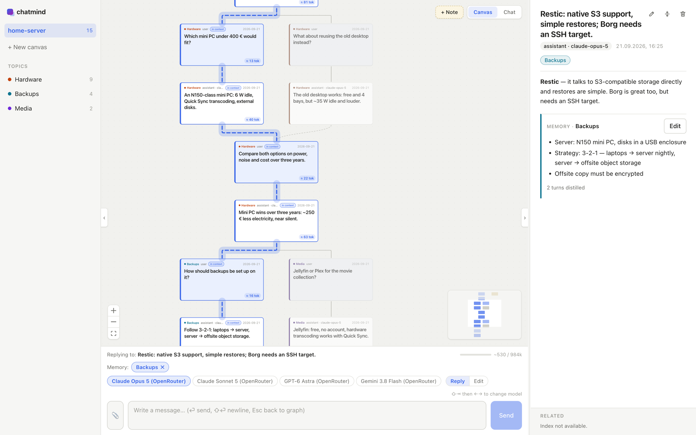

# chatmind

[](https://github.com/FabianGlueck/chatmind/actions/workflows/ci.yml)
[](LICENSE)

**Non-linear chat with LLMs, stored as plain Markdown in an Obsidian vault.**

Every message is a card on a canvas. Reply to any card to branch off, merge branches back together, and see exactly which cards the model gets as context. A background indexer summarises each card, groups cards into topics, links related answers across canvases and keeps a short memory per topic. Everything lives in a plain folder — one Markdown file per message plus a JSON Canvas — that Obsidian opens as a vault.



## Features

- **Branch anywhere** — reply to any card, not just the last one; every strand keeps its own context.
- **Merge** — select several cards as targets and ask one question across all of them.
- **Visible context** — the cards that go to the model are marked and joined by a thread, each with its token count; exclude any of them with one key.
- **Files are the truth** — one Markdown file per message with YAML frontmatter, plus a standard [JSON Canvas](https://jsoncanvas.org/) file. Edit them in Obsidian and chatmind follows live.
- **Topics, summaries and links** — an optional indexer gives every card a short summary and a topic, colours the canvas by topic, turns it into a topic map when you zoom out, and shows related answers across canvases.
- **Topic memories** — the facts and decisions of each topic are distilled into an editable memory that can go into the system prompt.
- **Notes, images, editing** — put plain notes on the canvas, paste screenshots into questions, edit any card by hand or let a model rewrite it (you accept or discard the preview).
- **Chat view** — read any strand as a plain linear chat and switch branches at forks.
- **Several providers** — Anthropic, OpenAI and OpenRouter.
- **Local-first** — the server binds to `127.0.0.1`; your messages go only to the model provider you pick.

## Quick start

Requirements: [Node.js](https://nodejs.org/) 22.22+ and [pnpm](https://pnpm.io/), plus an API key for at least one of Anthropic, OpenAI or OpenRouter. [Obsidian](https://obsidian.md/) is optional.

```bash
git clone https://github.com/FabianGlueck/chatmind.git
cd chatmind
pnpm install

mkdir -p ~/.config/chatmind
echo 'ANTHROPIC_API_KEY=sk-ant-...' >> ~/.config/chatmind/env

pnpm build && pnpm start      # → http://localhost:3210
```

For development, `pnpm dev` runs the API on :3210 and Vite on :5173 (open http://localhost:5173).

Your conversations are stored in `~/Documents/chatmind` (change it with `--data-dir` or `CHATMIND_DATA_DIR`). To browse them in Obsidian, choose "Open folder as vault" on that folder.

To try it with sample data first:

```bash
pnpm cli import-transcript apps/cli/fixtures/transcript.json --canvas demo --data-dir /tmp/chatmind-demo
pnpm build && pnpm start --data-dir /tmp/chatmind-demo
```

## Configuration

Settings are read from the environment, then from `~/.config/chatmind/env` (one `KEY=VALUE` per line; the file is named `env`, not `.env`). API keys never go into the data folder.

| Variable | Default | Purpose |
|---|---|---|
| `ANTHROPIC_API_KEY`, `OPENAI_API_KEY`, `OPENROUTER_API_KEY` | — | Provider keys. At least one is needed; the composer lists only models whose key is present. |
| `CHATMIND_DATA_DIR` | `~/Documents/chatmind` | Where the vault lives (`--data-dir` overrides it). |
| `CHATMIND_PORT` | `3210` | Server port (`--port` overrides it). |
| `CHATMIND_NO_INDEX` | off | `1` turns the background indexer off (same as `--no-index`). |
| `CHATMIND_SUMMARY_MODEL` | `openai/gpt-5.6-luna` | OpenRouter model for summaries, topic names and memories. |
| `CHATMIND_EMBED_MODEL`, `CHATMIND_EMBED_DIM` | `openai/text-embedding-3-small`, `1536` | OpenRouter embedding model and its dimension. |

The indexer runs only with an `OPENROUTER_API_KEY`. Topic and link thresholds can be tuned too — see [docs/indexing.md](docs/indexing.md).

## How it works

```
~/Documents/chatmind/
├── <canvas>/
│   ├── graph.canvas          # JSON Canvas 1.0: positions; edges derived from frontmatter
│   ├── nodes/
│   │   └── <ULID>-<slug>.md  # one message: frontmatter (id, role, parents, summary, topics…) + body
│   ├── attachments/          # pasted images
│   └── memories/<topic>.md   # topic memories
├── .trash/                   # deleted and compressed turns (never unlinked)
└── .app/index.db             # derived SQLite index — safe to delete, rebuilt on start
```

A message's `parents` in its frontmatter is the only source of structure; the canvas file only adds layout. The SQLite index is derived and disposable. The full format is specified in [the vault format design](docs/superpowers/specs/2026-09-11-chatmind-vault-format-design.md).

The repo is a pnpm monorepo:

| Package | |
|---|---|
| `packages/core` | Pure logic: graph, context assembly, vault reader/writer |
| `packages/index` | Background indexer: summaries, embeddings (SQLite + sqlite-vec), topics, links, memories |
| `apps/server` | [Hono](https://hono.dev/) API with SSE streaming via the [Vercel AI SDK](https://ai-sdk.dev/) |
| `apps/web` | Vite + React 19 + [React Flow](https://reactflow.dev/) frontend |
| `apps/cli` | Import, consistency check and indexer diagnostics |

## CLI

```bash
pnpm cli import-transcript <file.json> --canvas <slug>   # import a linear chat
pnpm cli check                                           # exit 0 = clean, 3 = repairs pending
pnpm cli index status                                    # what is embedded, summarised, pending
pnpm cli index topics --dry-run                          # replay topic assignment read-only
pnpm cli index retopic --canvas <slug>                   # re-assign indexer-written topics
pnpm cli index links --dry-run [--k <n>] [--min <score>] # print all semantic links
```

Every command takes `--data-dir <path>`.

## Documentation

- [Using chatmind](docs/usage.md) — keyboard, merging, chat view, notes, editing, compressing and more
- [The indexer](docs/indexing.md) — summaries, topics, semantic links, calibration and tuning
- [Design specs](docs/superpowers/specs/) and [implementation plans](docs/superpowers/plans/) — one per milestone; [notes](docs/superpowers/notes/) hold findings from testing

## Status

chatmind is a personal project under active development. The vault format is stable, but expect rough edges and changes in the UI. Data stays in plain files, so you can always read your conversations in Obsidian or any editor.

## Contributing

Issues and pull requests are welcome — see [CONTRIBUTING.md](CONTRIBUTING.md). To report a security issue, see [SECURITY.md](SECURITY.md).

## License

[MIT](LICENSE) © 2026 Fabian Glück
